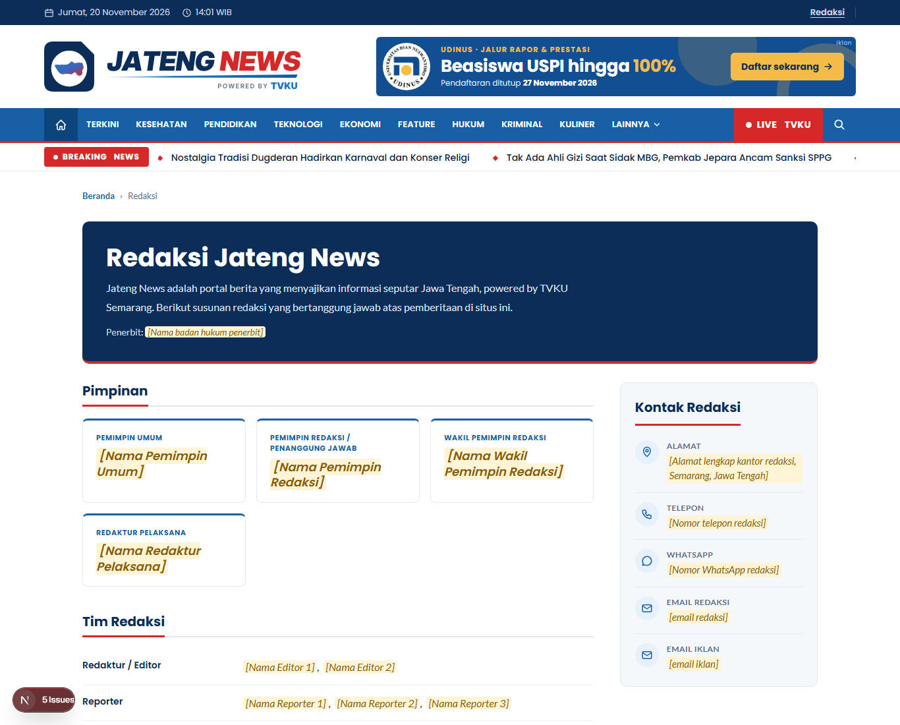

# Jateng News — Frontend Portal Berita

**Jateng News** adalah portal berita seputar Jawa Tengah, *powered by* **TVKU Semarang** (Televisi Kampus Universitas Dian Nuswantoro). Repositori ini berisi **frontend** situsnya: halaman yang dibuka pembaca untuk melihat berita terbaru, berita per kategori, detail berita, pencarian, dan susunan redaksi.

Situs: [jateng.news](https://jateng.news)


---

## Redesain frontend

Frontend ini **didesain ulang oleh Husin ([@husin14](https://github.com/husin14))**. Sebelumnya bagian berita masih memakai tampilan portal TVKU; sekarang punya identitas sendiri sebagai **Jateng News**.

Yang dikerjakan dalam redesain:

| Bagian | Perubahan |
|---|---|
| **Header** | Dibuat ulang: tanggal dan jam (WIB), logo Jateng News, slot iklan banner, menu kategori, tombol **LIVE TVKU** (ke tvku.tv/live), pencarian, dan baris *Breaking News* berjalan |
| **Menu kategori** | Menyesuaikan lebar layar. Di desktop, kategori yang tidak muat masuk ke menu **Lainnya**; di HP, menu bisa digeser ke samping, jadi tidak bertumpuk dengan tombol LIVE |
| **Beranda berita** | Tata letak baru: Berita Utama (1 besar + 5 samping), Berita Terbaru, Feature, dan daftar Kategori Berita |
| **Detail berita** | Tampilan baru: breadcrumb, label kategori, tombol bagikan (Facebook, X, WhatsApp, salin link), berita terkait, komentar Disqus, sidebar Terbaru dan Terpopuler. Versi lama disimpan di `show/_backup/` |
| **Halaman Redaksi** | **Baru** (`/redaksi`): susunan pimpinan, tim redaksi, manajemen, kontak redaksi, serta hak jawab dan koreksi |
| **Footer** | Baru, dengan logo Jateng News dan tautan Beranda dan Redaksi |
| **Gaya (CSS)** | Seluruh gaya baru ada di satu file dengan awalan `jn-`, jadi tidak bentrok dengan CSS tema lama |

Logika data (cache server, retry API, penanganan error), struktur URL, dan sistem iklan dikembangkan oleh tim developer TVKU. Redesain ini dipasang di atasnya tanpa mengubah cara kerja data.



---

## Teknologi

- [Next.js](https://nextjs.org) 16 (App Router, Turbopack)
- React 19 dan TypeScript 5
- Axios untuk mengambil data dari API TVKU
- CSS kustom (tanpa Tailwind)
- Dua bahasa: Indonesia (default) dan Inggris (`/en/...`)

Semua data berita diambil dari **API TVKU**, yang alamatnya diatur lewat `NEXT_PUBLIC_BASE_URL`. Repositori ini tidak menyimpan data berita.

---

## Halaman

| Alamat | Isi |
|---|---|
| `/` | Beranda berita |
| `/{id_kategori}`, contoh `/27` | Daftar berita per kategori |
| `/show/{slug}` | Detail berita |
| `/beritaterbaru` | Semua berita terbaru |
| `/search?search=kata` | Hasil pencarian |
| `/redaksi` | Susunan redaksi dan kontak |
| `/iklan/{id}` | Halaman iklan |
| `/en/...` | Versi bahasa Inggris dari semua alamat di atas |

---

## Menjalankan di komputer sendiri

**Yang dibutuhkan:** [Node.js](https://nodejs.org) versi 20 atau lebih baru.

1. Clone repositori lalu masuk ke foldernya:
   ```bash
   git clone https://github.com/husin14/frontend-jatengnews.git
   cd frontend-jatengnews
   git checkout develop-berita
   ```
2. Buat file `.env` dari contoh, lalu sesuaikan isinya:
   ```bash
   cp .env.example .env
   ```
   Variabel terpenting adalah `NEXT_PUBLIC_BASE_URL`, yaitu alamat API TVKU.
3. Install library:
   ```bash
   npm install
   ```
4. Jalankan server development:
   ```bash
   npm run dev
   ```
   Buka [http://localhost:3000](http://localhost:3000). Untuk memakai port lain, jalankan `npm run dev -- -p 3001`.

### Perintah lain

| Perintah | Fungsi |
|---|---|
| `npm run build` | Build versi produksi |
| `npm start` | Menjalankan hasil build |
| `npm run lint` | Memeriksa kode |

### Kalau semua halaman tiba-tiba 404

Kemungkinan cache Next.js rusak. Matikan server, hapus folder `.next`, lalu jalankan `npm run dev` lagi.

---

## Deploy dengan Docker

Linux:
```bash
{ docker rm -f frontend-tvku-public-berita-1 >/dev/null 2>&1 || true; } && { docker build -t frontend-tvku-public-berita:1 -f DockerfileSingle .; } && { docker run -d --add-host=host.docker.internal:host-gateway --env-file .env --name frontend-tvku-public-berita-1 --restart unless-stopped -p 3013:8080 frontend-tvku-public-berita:1; }
```

Windows (cmd):
```bat
(docker rm -f frontend-tvku-public-berita-1 >NUL 2>&1 || ver >NUL) && (docker build -t frontend-tvku-public-berita:1 -f DockerfileSingle .) && (docker run -d --add-host=host.docker.internal:host-gateway --env-file .env --name frontend-tvku-public-berita-1 --restart unless-stopped -p 3013:8080 frontend-tvku-public-berita:1)
```

Aplikasi akan berjalan di port `3013`.

---

## Struktur folder penting

```
src/
├── app/
│   ├── [lang]/
│   │   ├── (berita)/         # beranda, kategori, detail, terbaru, pencarian
│   │   ├── redaksi/          # halaman redaksi
│   │   └── iklan/            # halaman iklan
│   ├── components/
│   │   └── jn/               # komponen desain Jateng News (header, footer, kartu berita, CSS)
│   └── utils/                # klien API, cache, format tanggal
└── middleware.ts             # pengaturan bahasa (id/en)
public/images/                # logo dan gambar statis
```

Untuk mengisi data redaksi (nama, jabatan, kontak), ubah file `src/app/components/jn/redaksiData.ts`. Teks dalam `[kurung siku]` adalah data contoh yang belum diisi.

---

## Kredit

- **Redesain frontend (UI/UX):** Husin ([@husin14](https://github.com/husin14))
- **Pengembangan frontend dan backend:** Tim IT TVKU
- **Konten berita:** Redaksi Jateng News / TVKU Semarang
